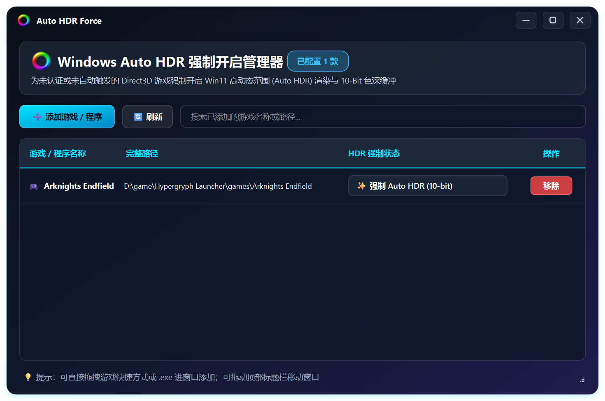

# 🌈 Auto HDR Force

<p align="center">
  
</p>

<p align="center">
  <strong>Windows Auto HDR 强制开启管理器（现代液态玻璃无边框 GUI 版本）</strong>
</p>

<p align="center">
  
  
  
  
</p>

---

## 🌟 界面预览 (Preview)



---

## ✨ 核心特性

- 🔮 **现代液态玻璃无边框设计**：纯自绘磨砂玻璃标题栏与窗口控制按键，告别 Windows 原生灰色边框。
- 📋 **游戏列表可视化**：自动扫描 Windows 注册表，完整呈现已添加游戏、路径及当前生效的 HDR 模式。
- 🎮 **文件拖拽与快速添加**：支持直接将游戏可执行程序 (`.exe`) 或桌面快捷方式 (`.lnk`) 拖入窗口极速录入。
- ⚡ **色彩模式即时切换**：
  - ⚪ **未开启**：清理 Direct3D 缓冲区升级项；
  - 💎 **强制 Auto HDR (8-bit)**：强制开启 Direct3D 缓冲区升级 (`BufferUpgradeOverride=1`)；
  - ✨ **强制 Auto HDR (10-bit)**：强制开启高动态范围渲染并启用 10-bit 色深缓冲 (`BufferUpgradeOverride=1;BufferUpgradeEnable10Bit=1`)。
- 🔍 **实时模糊搜索**：游戏库过多时，支持按游戏名或路径实时过滤。
- 🗑️ **一键安全移除**：选中游戏即可一键清理对应注册表项。

---

## ⚙️ 工作原理 (How it Works)

Windows 11 的 Auto HDR 功能本身存在白名单限制，许多老游戏或未适配游戏无法自动触发。本项目通过直接配置 Windows 注册表中的 Direct3D 驱动应用行为：

- 注册表根路径：`HKEY_CURRENT_USER\SOFTWARE\Microsoft\Direct3D`
- 在该键下为每个目标游戏分配独立子项（如 `Application0`, `Application1`...），并写入：
  - `Name`：目标可执行文件或快捷方式的绝对路径
  - `D3DBehaviors`：
    - `BufferUpgradeOverride=1`（强制 HDR 渲染管线）
    - `BufferUpgradeOverride=1;BufferUpgradeEnable10Bit=1`（启用 10-bit 色深支持）

---

## 🚀 快速开始

### 方式一：直接运行独立版 EXE
在 [Releases](https://github.com/Iridescent10-art/AutoHDR-Force/releases) 页面下载单文件绿色免安装版 `AutoHDR_Force.exe`，双击即可直接运行。

### 方式二：从源码运行
```bash
# 1. 克隆本仓库
git clone https://github.com/Iridescent10-art/AutoHDR-Force.git
cd AutoHDR-Force

# 2. 安装依赖
pip install PySide6 Pillow

# 3. 运行程序
python app.py
```

### 方式三：打包为独立 EXE
```bash
pip install pyinstaller
python create_icon.py
pyinstaller --noconsole --onefile --icon="icon.ico" --add-data="icon.png;." --name="AutoHDR_Force" app.py
```

---

## 📄 开源许可

本项目采用 [MIT License](LICENSE) 开源协议。
